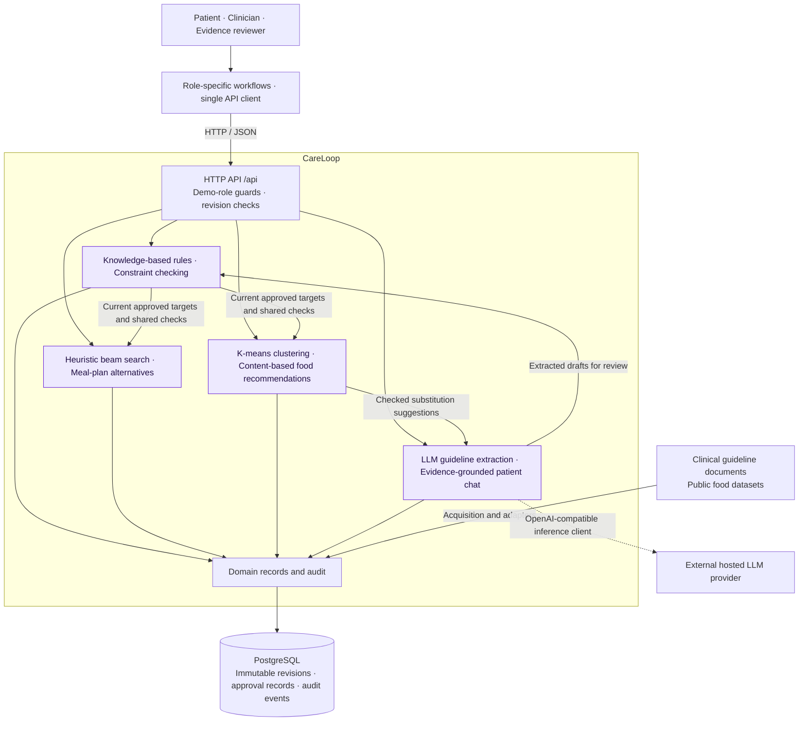
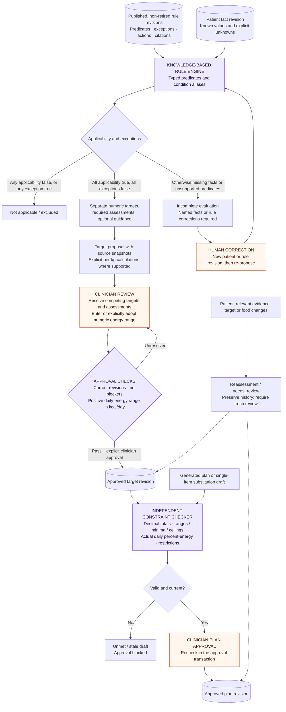
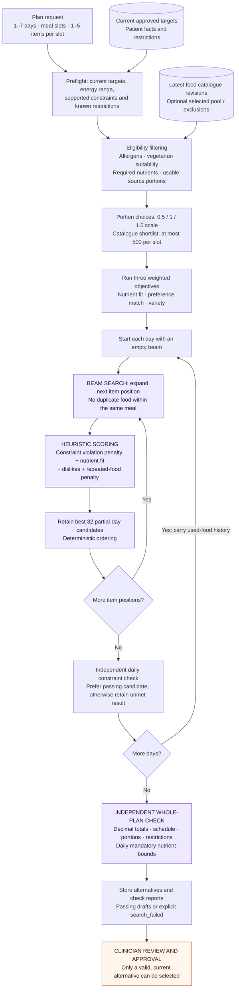
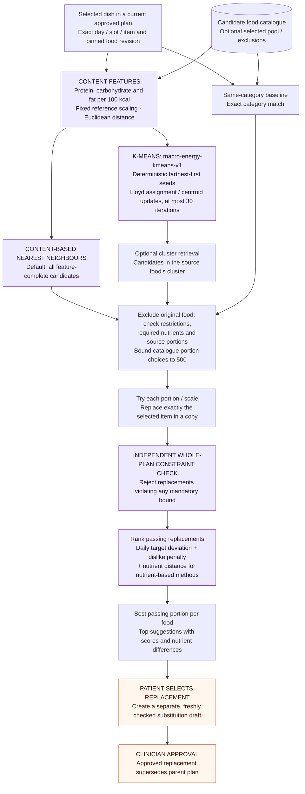
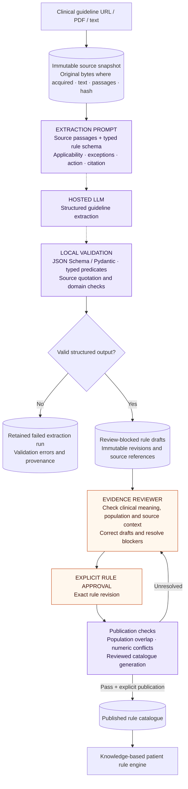
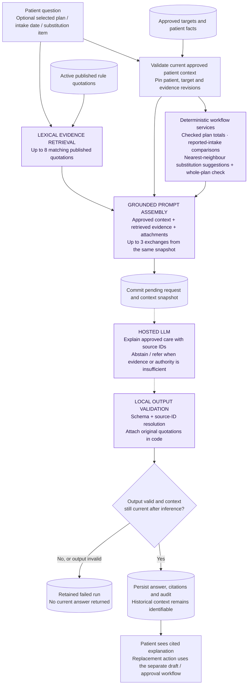

# Application structure

Implementation decision, 2026-10-23: one Python application, one PostgreSQL
database, and a workflow-oriented package layout. These are engineering choices,
not additional product requirements.

## Architecture diagrams

These views use the **C4 model's progressive zoom**: a container/component overview,
then algorithm and workflow detail. Mermaid flowcharts keep the diagrams editable
and renderable in Markdown. The detailed flows complement C4 rather than claiming
to be formal C4 deployment diagrams. They describe the implemented application.

1. [System overview](#system-overview)
2. [Decision automation](#decision-automation)
3. [Resource optimization](#resource-optimization)
4. [Knowledge discovery and mining](#knowledge-discovery-and-mining)
5. [Cognitive techniques: guideline extraction](#cognitive-techniques-guideline-extraction)
6. [Cognitive techniques: patient chat](#cognitive-techniques-patient-chat)

**Notation:** arrows show requests or data dependencies; dashed arrows show
reassessment or external inference. Purple nodes name computational techniques;
orange nodes mark human review/approval. Labels carry the meaning independently
of color. Database cylinders denote persistent records.

### System overview

One browser frontend, one modular Python backend, and one PostgreSQL database.
The four technique groups are modules inside the backend, not separate services.



The API uses local demo role labels, not authenticated identities. Numerical
reasoning, search, clustering, and checking execute locally. Hosted inference is
used for extraction and language generation. All writes and their audit events
commit together; provider calls occur outside database locks.

### Decision automation

**Techniques: knowledge-based rules, three-valued reasoning, constraint checking,
and human approval workflows.** Executable rules use typed predicates rather than
free-text interpretation at planning time.



Unknown is not false. A definite exclusion can decide a rule without requesting
unrelated missing facts. Optional guidance stays outside numerical constraints;
`intake` is a soft goal, while ranges, minima, and ceilings are mandatory.
See [patient contracts](PATIENTS.md) and [planning checks](PLANNING.md).

### Resource optimization

**Technique: deterministic heuristic beam search**, implemented as
`beam-source-portions-v5`. It searches food/portion combinations for nutrient fit,
preference match, and variety; it does not optimize monetary cost or inventory.



Eligibility failures return blockers before search. Oversized explicit custom pools
must be narrowed; automatic shortlisting applies to catalogue mode. Partial-day
scoring is a heuristic, not the final verdict. Search is bounded: failure does not
prove infeasibility, optimality is not guaranteed, and alternatives may coincide.
See [search and approval contracts](PLANNING.md#generation-and-approval).

### Knowledge discovery and mining

**Techniques: K-means clustering and content-based nearest-neighbour retrieval.**
Features describe food composition, not patient behaviour. Direct nearest-neighbour
retrieval is the default; cluster-restricted retrieval is an optional method.



Similarity requires positive energy and complete macronutrient features. Clustering
does not infer allergens or establish clinical suitability. The implementation fits
the model for the request and returns its metadata, but only the cluster method uses
memberships to restrict retrieval. The existing pilot did not show improved
similarity from clustering. See [mining methods and pilot](MINING.md).

### Cognitive techniques: guideline extraction

**Technique: LLM-assisted structured knowledge extraction**, followed by local
validation and reviewer-controlled publication.



The model produces drafts, not approved knowledge. Quotation validation establishes
text integrity, while reviewers assess interpretation. Approval and publication
are distinct operations. See [evidence lifecycle](EVIDENCE.md) and
[hosted inference](INFERENCE.md).

### Cognitive techniques: patient chat

**Technique: evidence-grounded LLM generation with lexical retrieval**
(retrieval-augmented generation), source-ID validation, and revision-bound context.



Chat explains existing records; deterministic services calculate nutrient totals
and check substitutions. An answer cannot change targets or approve a plan.
Source-ID validation verifies source identity, not semantic support for every
generated claim. See [patient conversation contracts](INFERENCE.md#patient-conversation).

### Technique-to-code map

| Technique | Primary implementation |
| --- | --- |
| Knowledge-based rules and three-valued predicates | `patients/engine.py`, `patients/conditions.py` |
| Target approval and reassessment | `patients/service.py`, `nutrition.py` |
| Independent constraint checking and plan approval | `planning/checker.py`, `planning/service.py` |
| Heuristic beam search | `planning/search.py` |
| K-means and content-based retrieval | `foods/clustering.py`, `planning/recommendations.py` |
| LLM guideline extraction and publication | `evidence/extraction.py`, `evidence/service.py`, `evidence/conflicts.py` |
| Evidence-grounded patient chat | `chat.py`, `answers.py`, `chat_workflows.py`, `inference.py` |

Paths above are relative to `src/careloop/`. All six diagrams were successfully
rendered with Mermaid CLI on 2026-10-25. To reproduce with a configured Chromium:

```sh
mmdc -i docs/ARCHITECTURE.md -o /tmp/opencode/careloop-architecture.svg
```

The CLI extracts the Mermaid fences and creates six numbered SVGs. This environment
used `-p /tmp/opencode/careloop-mermaid-puppeteer.json -j 2` to select the installed
`/usr/bin/chromium` with `--no-sandbox`. No live inference or database changes are
needed to render these views.

## Implemented layout

```text
src/careloop/
  api.py                  HTTP routes and application lifetime
  db.py                   Transactional migrations called by API startup
  workflow.py             Shared audit and demo-role transaction helpers
  ingestion.py            Public downloads and external artifact manifests
  inference.py            Shared configured OpenAI-compatible provider client
  answers.py              Cited-education prompts, schema validation, source-ID resolution
  chat.py                 Approved patient context, retrieval and persisted conversation turns
  chat_workflows.py       Plan/intake/substitution attachments and revision stamps
  evaluation/             Frozen experiments, independent audits and offline reports
  migrations/             Ordered, checksum-verified SQL migrations
  evidence/
    models.py             Input contracts and structural validation
    service.py            Transactional source/review/publication operations
    acquisition.py        Approved-domain HTTPS downloads and discovery
    documents.py          Bounded document parsing and passages
    conflicts.py          Structured population/numeric conflict checks
    extraction.py         Hosted extraction runs and review-blocked drafts
  patients/               Facts, CSV import, applicability, target review, routes
  adapters/               Source format → domain model translation (no side effects)
  foods/                  Versioned nutrients, portions, reviewer annotations
  planning/               Bounded search, independent checking, approvals/substitutions
  logging/                Intake revisions, completeness, and target comparisons
  evaluate_foods.py        Reproducible public-food retrieval pilot
tests/                    Workflow and PostgreSQL integration tests
ui/
  src/App.tsx             Application shell, routing and demo session
  src/api.ts              Single typed API client and contracts
  src/state.ts            Shared session and asynchronous request state
  src/navigation.ts       Shared role-specific browser route and menu definitions
  src/screens/            Patient/reviewer/clinician workflows, extraction and cited chat
  src/components/         Shared headers and form/display controls
```

Food clustering lives in `foods/clustering.py`. Share database access and audit conventions;
avoid separate services, generic repositories, a second knowledge database, or
mirroring every HTTP resource into multiple abstraction layers.

## Evidence persistence and consistency

- Sources are immutable text snapshots with title, edition, locator, timestamp,
  and SHA-256. URL/PDF imports also retain original bytes, parser metadata, and
  passages. New editions are new snapshots; URL acquisition is restricted to
  approved domains. See [evidence](EVIDENCE.md) for acquisition limits.
- Rules have immutable revisions. A revision records applicability, exceptions,
  recommendation type, amount/unit where appropriate, source quote/location, and
  unresolved blockers. Quoted text must occur verbatim in the submitted snapshot.
  This checks quotation integrity, not the scientific truth of the interpretation.
- Approval references the exact revision. An edit creates an unapproved revision
  and leaves the earlier published revision available. Self-approval is allowed.
- Approval/publication accept one or multiple explicit rule/revision references.
  Send a source's selected rule IDs for source-level or partial-source review.
  Each submitted selection is atomic; split a selection to review only its valid
  members. Duplicate selections and stale revisions are rejected.
- Publication records a permanent membership list and changes active pointers in
  the same transaction. Publication is distinct from approval. Retirement retains
  the historical active pointer and marks the rule ineligible for future use.
- Publication checks structured population overlap and same-unit numeric conflicts
  against selected and retained active rules. Broader clinical interpretation
  remains manual: reviewers resolve blockers through audited revisions and provide
  a conflict-review note. See [conflict analysis](EVIDENCE.md#structured-conflict-analysis).
- A database-held catalogue lock serializes evidence writes. Publication includes
  the catalogue generation reviewed; any intervening write invalidates it. This
  conservative mechanism fits the small local reviewer workflow. Concurrent edits
  use expected revisions and cannot silently overwrite each other.
- Mutations and audit events commit together. Source and rule history is exposed
  for inspection; no deletion or history-rewrite API is supplied. Database owners
  can still modify storage: this is an application audit trail, not tamper-proof
  infrastructure.

## Contract boundary

Routes use `/api/`. FastAPI generates the current contract at `/openapi.json` and
interactive documentation at `/docs`.

Each write carries `actor: {name, role}` and `reason`. Reviewer actions require the
reviewer label. These labels implement demo workflow guards, not authentication.
Reads are available across the local demo. Keep the deployment loopback-bound.
Patient requests cover generation, substitutions, logging, and chat; clinician
writes cover patient facts, targets and plan approval. Browser routes use explicit
`/patient/`, `/clinician/`, and `/reviewer/` prefixes and descriptive hyphenated names.
Disallowed browser routes redirect to the selected role's home without mounting
the other role's workspace. Clinician intake review is read-only.

`GET /api/evidence/catalogue` returns one consistent snapshot of the generation,
drafts, approval labels, published bodies, and retirement state. Consumers must
exclude retired rules and must not mistake a draft for its published body.
`GET /api/evidence/rules/{id}` includes all revisions. Publications and audit
events have separate read endpoints.

Applicability evaluation now supports a bounded, typed fact vocabulary and
three-valued missing-fact semantics. See [patient contracts](PATIENTS.md) for
supported units, explicit per-kg arithmetic, clinician completion, and limits.

## Workflow integration

Patient target approvals bind immutable patient facts and published rule revisions.
Evidence publication/retirement re-evaluates patient snapshots and flags affected
targets in the same transaction, including newly relevant evidence. Patient edits
flag their target sets. The shared catalogue lock serializes these writes with
approval; patient audit events do not increment the evidence catalogue generation.
Planning consumes only approved, current targets and adds food/restriction checks.
Target readiness alone is not sufficient for planning. Food and target changes
flag affected plans transactionally, while their pinned snapshots remain readable.

Acquired sources and hosted extraction feed the structured draft contract and
share its review boundary. Model experiments live in `notebooks/`; data-source pilots remain separate,
measurable work; neither clinical rules nor generated patient cohorts are seeded.
The NHANES adapter translates explicitly selected public demographic records; no
diagnoses, target approvals, or clinical histories are inferred. SG FoodID and
FNDDS adapters translate food records. Acquisition and output artifacts belong to
`ingestion.py`, including transaction-scoped import functions with explicit actors/reasons.
Adapters only read source formats and construct domain models. See
[foods](FOODS.md) and [planning](PLANNING.md) for unit and lifecycle contracts.
